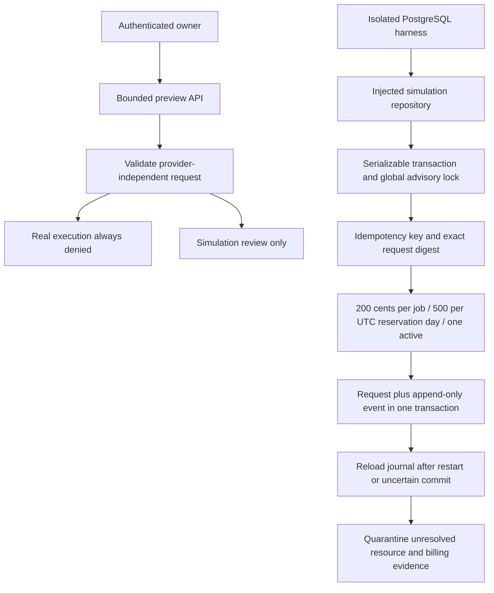

# Phase 20 gateway architecture

The gateway is a **simulation journal**, not a purchase executor, financial ledger or dispatch outbox. Application startup does not construct a PostgreSQL gateway, load its schema or install a provider execution adapter. No flag enables real operation.

## Request and authority

`GatewayRequest` binds provider, account, offer, customer, workload, GPU model/count/VRAM, capped integer cost/runtime and contract/supplier/payment/approval evidence references. Unknown fields reject. Reference IDs are **not** proof that evidence is valid. A journal reservation reserves fictional exposure only, never supplier capacity or real customer funds. Database constraints retain `SIMULATION_ONLY`, `execution_authorized=false` and zero real money moved.

The HTTP owner APIs are `/api/owner/phase20/readiness`, `/gateway-preview` and `/quote-preview`. They have actual owner middleware, a separate 30/minute limiter, no-store responses and a 32 KiB model input bound. They cannot access a supplied database, collector, signer or provider method. When an upstream global JSON parser has already parsed a body, the model-size check still applies; upstream parsing retains the existing global limit.

`denyRealExecution()` is unconditional, including under LIVE configuration. The existing `requestPurchase` stub retains its denial contract and shares the new denial policy. Existing provisioning/financial blockers remain in place. A single **real** audited dispatch gateway does not yet exist, and legacy execution implementations have not been removed. They remain blocked, rather than being activated to demonstrate consolidation.

## Durable lifecycle

`SIMULATION_RESERVED → SIMULATION_RUNNING → STOP_REQUIRED → SIMULATION_RECONCILED`; uncertainty leads to `QUARANTINED`. Cancellation is allowed before running. Reconciliation requires a bound, recent simulated resource observation, final invoice reference, cost below the cap, on-time stop and no continuing charges. A claim of an independent provider stop is quarantined until an actual verifier exists. None of these states means a provider stopped charging.

Reservation creation serializes across processes with advisory lock `20261120` and SERIALIZABLE isolation. Known-aborted serialization/deadlock transactions retry at most three times. Lost COMMIT acknowledgement returns `OUTCOME_UNKNOWN_RELOAD_IDEMPOTENCY_KEY`; it is not automatically repeated as a dispatch. Reloading/repeating the same key and identical digest finds the original journal record. A changed payload conflicts. Each transition locks its row, checks a version and deduplicates its event key. Global caps are separate from per-request version protection.

Cutoff decisions handle runtime, cost, unknown/orphan state, stale observations, backoff, three-attempt exhaustion, missing final invoice and continuing charges. Journaled stop attempts survive restart. An expired reservation cannot enter running state. `recoverOutstanding` returns a bounded human-review list; it is not a background worker and issues no cancellation. The provisioning simulator is a pure deterministic projection bound to the exact journal request digest; it creates no infrastructure or capacity claim. Simulation cancellation is deterministic and accepts only `sim:` resource IDs. Real cancellation is denied.

## Audit and persistence

The new SQL is only `docs/migration-proposals/20261112_phase20_simulation_journal.sql`, outside automatic migration registration. No production schema is created or updated. The Phase 19.1 proposal also remains unapplied to production.

Request identity/budgets/deadlines are immutable after insertion. Database triggers enforce initial state, legal transitions, version advancement and persisted stop counters. A deferred constraint requires the matching audit event in the same transaction. Event UPDATE/DELETE are rejected; hash links bind sequence, kind, request ID and payload digest. Audit checks compare event count/head state with the request version and rehash its original payload. These are tamper-evident local controls, not WORM storage, signatures or protection against an administrator disabling triggers/rewriting an entire chain. Evidence observation digests are journaled; a production immutable receipt archive and external hash anchoring remain dependencies.

Caps are reservation-journal caps, not certified accrued-cost accounting or actual provider spend controls. No reservation expires into spendable real money. Production DB-role privileges, full baseline upgrades, isolation under real workload and multi-replica crash certification remain unverified.
