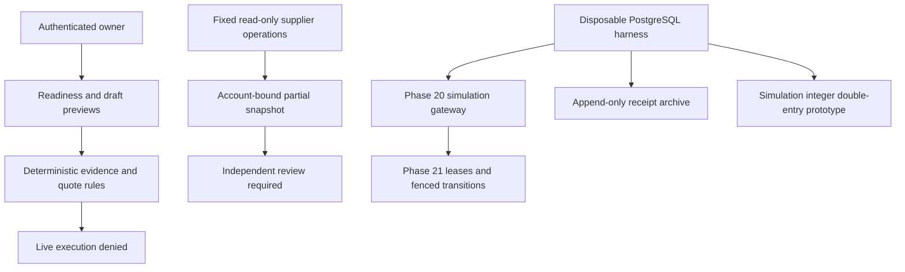

# Phase 21 architecture

The deployable product remains discovery/simulation only. `liveOperationsAllowed()` is an unconditional false; emergency-stop has no disarm capability. No Phase 21 ledger, lease, receipt archive or provider executor is constructed by server startup.

`server/phase20/gateway.ts` owns simulation reservation and lifecycle transitions. Request digest and unique key, serializable transactions, global exposure lock, row versions, append-only hash events and bounded known-abort retries remain. Unknown COMMIT never retries a purchase. All provider adapters can only simulate a deterministic `sim:` resource. Optional worker leases are checked under the same transaction as state writes; `workerLease.ts` uses PostgreSQL clock and monotonically increasing fencing tokens. Unfenced manual simulation transitions remain available for offline review. There is no production dispatcher, multi-region lease authority or live purchase gateway certification.

`providerContract.ts` validates recorded provider/account/region allowlists and complete hardware, charge, minimum-billing and cancellation metadata; it never claims availability. `supplierReadOnly.ts` pins public DNS, validates TLS, forbids redirects, bounds requests to six seconds and responses to 1 MiB. Fixed Vast search POST and RunPod GraphQL queries contain no mutation. Transport injection is isolated-test-only. Snapshots retain digest and explicitly missing commercial fields; they do not sign themselves or become independent evidence from an origin flag.

`EvidenceAuthority` accepts reviewed Ed25519 public roots, kind restrictions, validity windows and conservative revocation. A new issuer ID/public key implements rotation; roots are copied on construction. `EvidenceArchive` persists normalized receipts and quarantines conflicting issuer/event bindings forever; re-reading recalculates digest, expiry and current trust. Production roots/archive installation and external immutable anchors remain absent.

`LedgerLab` requires explicit isolated-test mode and no DATABASE_URL. It uses integer strings/BigInt, transactional two-entry posting, owner/currency isolation, unique event digest, exact full reversals and nonnegative balances. Deferred constraints reject unbalanced or later corrupting entries. It is a disposable accounting prototype with synthetic opening balances, not the authoritative certified financial ledger. Historical float repositories remain disabled and uncertified.

`AdvisoryAgentRunner` implements 12 bounded preparation roles. LLM strings have no authorization meaning or tool access. The caller must supply authorized non-secret inputs; results are untrusted recommendations with deterministic digest and zero execution permissions. No autonomous agent fleet or paid model usage is started.

Production config requires explicit DISCOVERY_ONLY, strong distinct backend secrets, strict owner auth, exact Render revision and certificate-validating PostgreSQL. Startup excludes treasury initialization and financial workers; readiness requires completed bootstrap plus live schema/DB probe. Shutdown drains HTTP and closes DB within ten seconds. HTTP security headers and bounded bodies are installed. Single-process rate limits and sessions remain deployment constraints.
